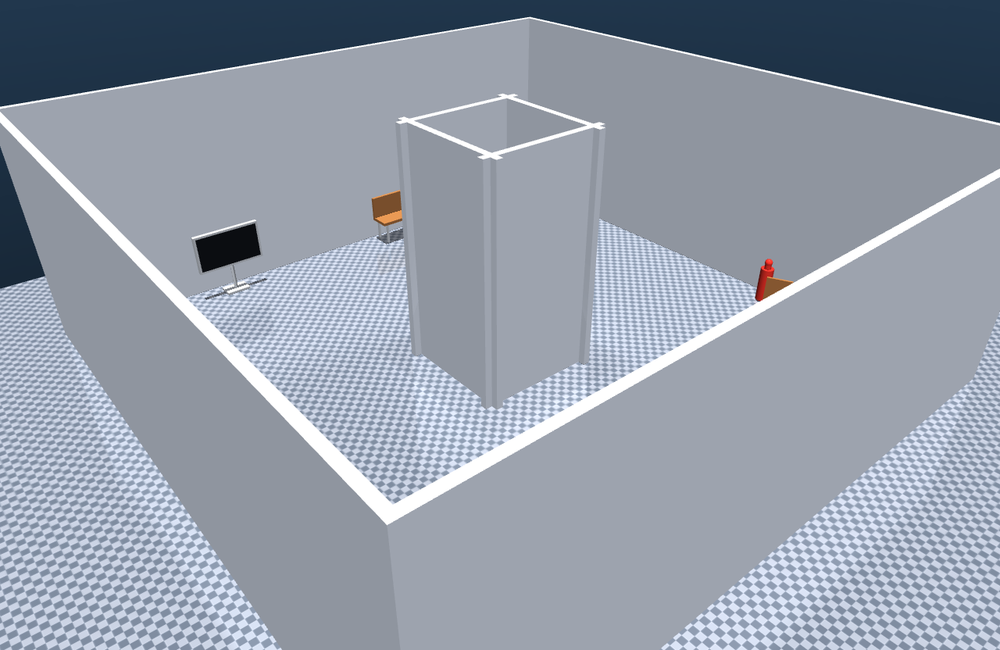
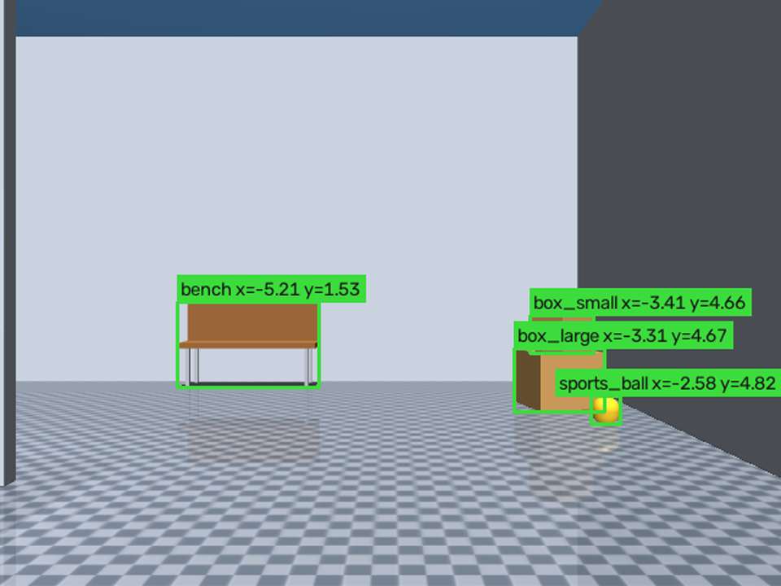
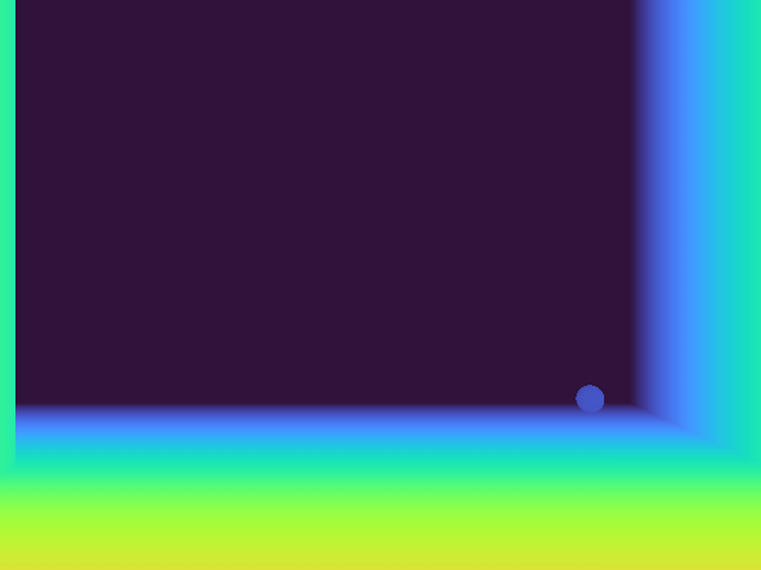
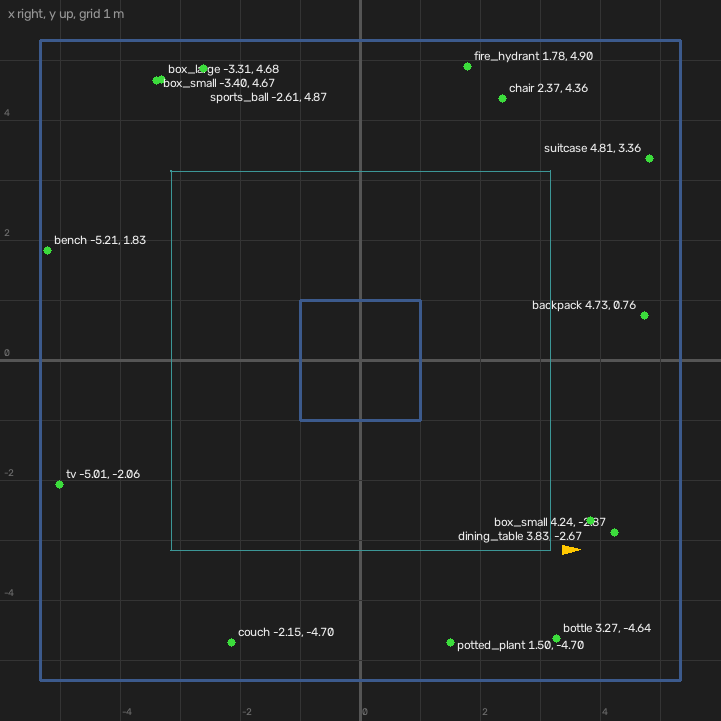

# mappex

**Indoor object mapping with a simulated drone.**

A small, self-contained robotics project: a Skydio X2 quadrotor flies a corridor
inside MuJoCo, sees the world through a forward camera, recognises the objects in
front of it with a YOLO detector, converts each detection into a world position
using the depth buffer, and draws everything onto a 2D map with OpenCV.

This is a learning project. It started as an experiment in drone flight control,
synthetic data generation and monocular depth, and it is being documented as it
grows: the code is deliberately small, split by responsibility, and every module
can be read in one sitting.

<p align="center">
  
</p>

---

## What it does

The drone takes off, flies a closed square around the corridor and, while it
moves, turns every camera frame into map entries:

| Perception                             | Geometry                                         | Map                                                      |
| -------------------------------------- | ------------------------------------------------ | -------------------------------------------------------- |
| YOLO finds the object boxes            | the depth buffer gives metric distance           | observations are merged per object and drawn with OpenCV |
| 13 classes: chair, bench, couch, tv, … | pixels are back-projected into world coordinates | output is a top-down PNG with names and coordinates      |

<p align="center">
  
  &nbsp;
  
</p>
<p align="center">
  <em>Left: YOLO detections with their estimated world coordinates. Right: the depth buffer that gives those coordinates their scale.</em>
</p>

<p align="center">
  
</p>
<p align="center">
  <em>The generated map: walls in blue, the flight trail, the drone with its heading, and every object with its position in metres.</em>
</p>

---

## How it works

```
mujoco/models/corridor.xml        the scene: two walls, 13 everyday objects
            │
            ▼
  mappex/dataset.py  ────────────►  data/<class>/  ──►  mappex/train.py  ──►  weights/
            │                        (renders)            (YOLO fine-tune)
            │
            ▼
  mappex/simulation.py   physics, flight primitives, colour + depth streams
            │
            ▼
  mappex/detector.py     boxes from YOLO, world point per box
            │                    │
            │                    ▼
            │            mappex/depth.py      pinhole maths: pixel + depth → world
            ▼
  mappex/mapping.py      clusters observations, renders the map with OpenCV
            ▲
            │
  mappex/pipeline.py     the exploration loop that ties it together
```

A few decisions worth knowing:

- **The centre pixel of a detection is unreliable.** It often lands on the wall
  behind the object. Instead the whole box is used: take the nearest depth
  percentile inside it and keep the pixels within a thin band, which is the
  object's front face.
- **Objects are re-observed constantly.** A single chair is detected in dozens
  of frames from slightly different angles, so observations are merged into
  clusters by distance, and clusters that still sit close together are collapsed
  when drawing. This is what keeps one label per object.
- **Weights are never hard-coded.** The detector looks for them in the given
  path, then `$MAPPEX_WEIGHTS`, then `weights/room_detection.pt`, then the newest
  Ultralytics run under `runs/`.

---

## Reproducing it

### Requirements

- Python 3.10+
- Linux or macOS (MuJoCo's classic renderer needs a GPU-backed OpenGL context;
  on macOS run inside `mjpython` if you want the interactive viewer)

### 1. Install

```bash
python -m venv .venv
source .venv/bin/activate
pip install -r requirements.txt
```

### 2. Generate the dataset

The detector is trained on synthetic images, so there is nothing to download.
This renders every object in the scene from a ring of viewpoints:

```bash
python -m mappex.dataset --per-class 300 --angles 10
```

It writes `data/<class>/` with PNGs and a `labels.json` per class. Expect it to
take a while: the full 13-class set is a few thousand renders.

### 3. Train

```bash
python -m mappex.train --epochs 4 --device mps   # use --device cpu / cuda as needed
```

This assembles `data/` into the YOLO layout (`yolo_dataset/`) and fine-tunes a
small checkpoint. The resulting `best.pt` is found automatically; copy it to
`weights/room_detection.pt` if you prefer a stable path:

```bash
cp runs/detect/**/best.pt weights/room_detection.pt
```

### 4. Map

```bash
python main.py                      # opens camera and map windows
python main.py --headless -o map.png  # CI / no display
```

The run prints one line per mapped object and writes `map.png`.

### 5. Screenshots

```bash
python -m scripts.capture_docs
```

Regenerates everything in `docs/images/` from the current weights.

---

## Project layout

```
mappex/
  scene.py       constants and the scene path
  simulation.py  drone physics, flight primitives, camera streams
  depth.py       pinhole camera maths (intrinsics, pose, unprojection)
  detector.py    YOLO wrapper, weights resolution, object localisation
  mapping.py     observation clustering and the OpenCV map renderer
  dataset.py     synthetic dataset generation
  train.py       dataset assembly and YOLO training
  pipeline.py    the exploration loop and its CLI
scripts/
  capture_docs.py  regenerates the README screenshots
docs/images/       screenshots
mujoco/models/     the scene and the drone model (Apache-2.0)
tests/             unit tests for the geometry and the map
```

Datasets, trained weights and run output are git-ignored: the repository holds
source, the scene, and the instructions to rebuild everything else.

## Tests

```bash
python -m pytest
```

The tests cover the parts that are easy to get subtly wrong: pixel ↔ world
round-trips, and the map's merging and de-duplication rules.

## Limitations

- Single camera, no loop closure: positions are accurate to roughly 0.1–0.5 m,
  and accuracy depends on how well the depth buffer samples the object's face.
- Occlusion is not modelled explicitly; a detection whose visible surface is
  mostly background will land behind the object.
- The detector knows 13 classes, all from the corridor scene.

## Credits

The Skydio X2 model and scene are Apache-2.0 licensed (see
`mujoco/models/LICENSE`). Built with [MuJoCo](https://mujoco.org),
[Ultralytics YOLO](https://docs.ultralytics.com), [OpenCV](https://opencv.org)
and to a large extent curiosity.

## License

No license has been specified for the project source. The Skydio X2 model and
scene files under `mujoco/models/` are Apache-2.0 licensed; see the included
license file.
